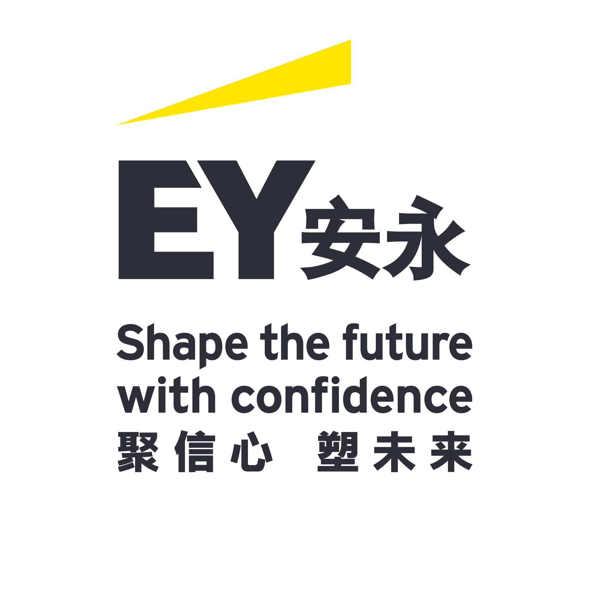

# 安永
> 原文链接: https://careers.ey.com.cn/campus-recruitment/ey/166374?locale=zh-CN/#/job/3f07f2cc-f41e-4a61-9203-7ff249953423

---

2026-2027年安永秋季应届毕业生校园招聘项目

分享

全职|其他|全部业务线|中国

发布于 2026-08-04

申请职位

-   [首页](#/)/
-   [职位列表](#/jobs)/
-   职位详情/

2026-2027年安永秋季应届毕业生校园招聘项目

分享

全职|其他|全部业务线|中国

发布于 2026-08-04

申请职位

职位描述

在快速变革的AI时代，你是否愿意与我们E启新程，重塑未来？

无论你是解码未来的技术先锋，还是重塑规则的商业操盘手，安永都为你预留了最广阔的舞台。在这里，年轻不是标签，而是改变世界的力量。

加入安永，不只是开启一份职业，更是启动一场关于自我重塑的旅程。在多元包容的文化中碰撞思想，在全球化的视野中锚定方向，让每一次“敢想敢为”，都成为塑造未来的基石。

安永诚邀你以青春锋芒奔赴新征程，手握未来话语权，在逐梦路上乘风破浪，成就无可替代的自己！

**E启新程，你将获得：**

**▪ 聚力成长，自信启航**：纵享面向未来的课程资源，提升变革型领导力。

▪ **无界协作，塑造可能**：融汇全球视野，跨界深度协作，拓展认知边界。

▪ **全心支持，状态满格**：优享薪酬福利和身心健康支持，夯实成长底气，全速奔赴目标。

▪ **价值共创，点亮未来**：体验卓越职场，释放专业潜能，共同建设更美好的商业世界。

安永是全球领先的审计、咨询、税务、战略与交易咨询服务机构之一。点击以下岗位链接，了解更多详情！

审计

▪ 外部审计（[请点击查看更多](https://v.xiumius.cn/stage/v5/37SIV/717009516)）

▪ 法证及诚信合规服务（[请点击查看更多](https://v.xiumius.cn/stage/v5/37SIV/717009991)）

▪ 财务会计咨询服务（[请点击查看更多](https://v.xiumius.cn/stage/v5/37SIV/717010219)）

▪ 气候变化与可持续发展服务（[请点击查看更多](https://v.xiumius.cn/stage/v5/37SIV/717010378)）

▪ 科技风险及数据智能服务（[请点击查看更多](https://v.xiumius.cn/stage/v5/37SIV/717010691)）

咨询

▪ 科技创新咨询服务（[请点击查看更多](https://v.xiumius.cn/stage/v5/37SIV/717045479)）

▪ 风控与安全咨询服务（[请点击查看更多](https://v.xiumius.cn/stage/v5/37SIV/717010995)）

▪ 企业转型咨询服务（[请点击查看更多](https://v.xiumius.cn/stage/v5/37SIV/717011121)）

▪ 战略创新咨询服务（[请点击查看更多](https://v.xiumius.cn/stage/v5/37SIV/717011378)）

税务（[请点击查看更多](https://v.xiumius.cn/stage/v5/37SIV/717011549)）

战略与交易咨询（[请点击查看更多](https://v.xiumius.cn/stage/v5/37SIV/717011657)）

金融服务

▪ 金融咨询（[请点击查看更多](https://v.xiumius.cn/stage/v5/37SIV/717011939)）

▪ 金融科技与创新（[请点击查看更多](https://v.xiumius.cn/stage/v5/37SIV/717012272)）

任职要求

▪2026-2027年中国籍高校毕业生，本科及以上学历。

▪不限专业，大量岗位欢迎理工科、商科、人文社科等专业的学生加入！包括但不限于计算机类、大数据类、工程类、财会 类、金融类、管理类、语言类、法律类等。请通过上方各岗位链接了解详细工作内容。

▪具有出色的学习能力、团队合作精神，积极主动，并有志于在专业服务领域发展。

▪具有良好的中英文口语和书面表达能力，部分岗位优先考虑日语N1、韩语TOPIK II证书持有者。

▪有使用数据可视化工具经验的优先，如Tableau, Power BI，或能使用计算机语言(如R, Python, SAS, SQL) 进行数据分析或建模。

在快速变革的AI时代，你是否愿意与我们E启新程，重塑未来？

无论你是解码未来的技术先锋，还是重塑规则的商业操盘手，安永都为你预留了最广阔的舞台。在这里，年轻不是标签，而是改变世界的力量。

加入安永，不只是开启一份职业，更是启动一场关于自我重塑的旅程。在多元包容的文化中碰撞思想，在全球化的视野中锚定方向，让每一次“敢想敢为”，都成为塑造未来的基石。

安永诚邀你以青春锋芒奔赴新征程，手握未来话语权，在逐梦路上乘风破浪，成就无可替代的自己！

**E启新程，你将获得：**

**▪ 聚力成长，自信启航**：纵享面向未来的课程资源，提升变革型领导力。

▪ **无界协作，塑造可能**：融汇全球视野，跨界深度协作，拓展认知边界。

▪ **全心支持，状态满格**：优享薪酬福利和身心健康支持，夯实成长底气，全速奔赴目标。

▪ **价值共创，点亮未来**：体验卓越职场，释放专业潜能，共同建设更美好的商业世界。

安永是全球领先的审计、咨询、税务、战略与交易咨询服务机构之一。点击以下岗位链接，了解更多详情！

审计

▪ 外部审计（[请点击查看更多](https://v.xiumius.cn/stage/v5/37SIV/717009516)）

▪ 法证及诚信合规服务（[请点击查看更多](https://v.xiumius.cn/stage/v5/37SIV/717009991)）

▪ 财务会计咨询服务（[请点击查看更多](https://v.xiumius.cn/stage/v5/37SIV/717010219)）

▪ 气候变化与可持续发展服务（[请点击查看更多](https://v.xiumius.cn/stage/v5/37SIV/717010378)）

▪ 科技风险及数据智能服务（[请点击查看更多](https://v.xiumius.cn/stage/v5/37SIV/717010691)）

咨询

▪ 科技创新咨询服务（[请点击查看更多](https://v.xiumius.cn/stage/v5/37SIV/717045479)）

▪ 风控与安全咨询服务（[请点击查看更多](https://v.xiumius.cn/stage/v5/37SIV/717010995)）

▪ 企业转型咨询服务（[请点击查看更多](https://v.xiumius.cn/stage/v5/37SIV/717011121)）

▪ 战略创新咨询服务（[请点击查看更多](https://v.xiumius.cn/stage/v5/37SIV/717011378)）

税务（[请点击查看更多](https://v.xiumius.cn/stage/v5/37SIV/717011549)）

战略与交易咨询（[请点击查看更多](https://v.xiumius.cn/stage/v5/37SIV/717011657)）

金融服务

▪ 金融咨询（[请点击查看更多](https://v.xiumius.cn/stage/v5/37SIV/717011939)）

▪ 金融科技与创新（[请点击查看更多](https://v.xiumius.cn/stage/v5/37SIV/717012272)）

任职要求

▪2026-2027年中国籍高校毕业生，本科及以上学历。

▪不限专业，大量岗位欢迎理工科、商科、人文社科等专业的学生加入！包括但不限于计算机类、大数据类、工程类、财会 类、金融类、管理类、语言类、法律类等。请通过上方各岗位链接了解详细工作内容。

▪具有出色的学习能力、团队合作精神，积极主动，并有志于在专业服务领域发展。

▪具有良好的中英文口语和书面表达能力，部分岗位优先考虑日语N1、韩语TOPIK II证书持有者。

▪有使用数据可视化工具经验的优先，如Tableau, Power BI，或能使用计算机语言(如R, Python, SAS, SQL) 进行数据分析或建模。

职位信息

职位名称

职位名称

2026-2027年安永秋季应届毕业生校园招聘项目

2026-2027年安永秋季应届毕业生校园招聘项目

薪资范围

薪资范围

\-

\-

职位性质

职位性质

全职

全职

职能类型

职能类型

其他

其他

所属部门

所属部门

全部业务线

全部业务线

工作地点

工作地点

中国

中国

发布日期

发布日期

2026-08-04

2026-08-04

公司信息

安永

安永在大中华区的成员机构由本土合伙人拥有及管理。在审计、咨询、战略、税务与交易的专业服务领域， 安永团队对当前最复杂迫切的挑战，提出更好的问题，从而发掘创新的解决方案。 1968年，安永开始谱写在大中华区逾半个世纪的熠熠长卷。半个多世纪以来，我们为客户提供卓越的全方位专业服务，成为众多大中华区客户值得信赖的战略伙伴和咨询顾问。我们以一流人才、创新精神，坚守社会责任，引领高质量可持续发展，取得了今天的成功。 安永大中华区拥有24,000名专业人员，其中包括逾1,000名合伙人。我们在以下34个办事处地点为客户提供服务：北京、上海、香港、深圳、广州、澳门、 长沙、成都、重庆、大连、海口、杭州、合肥、济南、昆明、南京、宁波、前海、青岛、沈阳、苏州、太原、天津、武汉、厦门、西安、郑州、新竹、高雄、台中、台南、台北、桃园和乌兰巴托。 在未来，我们将继续发挥专业优势，构筑共益生态， 建立资本市场信任，积极推动大中华区可持续发展。 EY member firms in the Greater China region are owned and managed by local Partners. Working across assurance, consulting, strategy, tax and transactions, we ask better questions to find new answers for the complex issues facing our world today. In 1968, EY embarked on a remarkable journey in the Greater China region. For over half a century, we have established ourselves as a trusted partner and advisor to businesses in the region, delivering seamless and exceptional multidisciplinary services. Our success today has been achieved through our relentless attention to talent development, ongoing commitment to innovation, social responsibility and long-term value creation, as well as continuous contributions to foster high quality and sustainable growth. With 24,000 professionals and more than 1,000 Partners in the EY Greater China Region, we support our clients through 34 office locations: Beijing, Shanghai, Hong Kong, Shenzhen, Guangzhou, Macau, Changsha, Chengdu, Chongqing, Dalian, Haikou, Hangzhou, Hefei, Jinan, Kunming, Nanjing, Ningbo, Qianhai, Qingdao, Shenyang, Suzhou, Taiyuan, Tianjin, Wuhan, Xiamen, Xi’an, Zhengzhou, Hsinchu, Kaohsiung, Taichung, Tainan, Taipei, Taoyuan and Ulaanbaatar. We will continue to build on our unique strengths, positively impact the communities in which we operate, build trust in capital markets and play our part in advancing the region’s sustainable growth.

安永

安永在大中华区的成员机构由本土合伙人拥有及管理。在审计、咨询、战略、税务与交易的专业服务领域， 安永团队对当前最复杂迫切的挑战，提出更好的问题，从而发掘创新的解决方案。 1968年，安永开始谱写在大中华区逾半个世纪的熠熠长卷。半个多世纪以来，我们为客户提供卓越的全方位专业服务，成为众多大中华区客户值得信赖的战略伙伴和咨询顾问。我们以一流人才、创新精神，坚守社会责任，引领高质量可持续发展，取得了今天的成功。 安永大中华区拥有24,000名专业人员，其中包括逾1,000名合伙人。我们在以下34个办事处地点为客户提供服务：北京、上海、香港、深圳、广州、澳门、 长沙、成都、重庆、大连、海口、杭州、合肥、济南、昆明、南京、宁波、前海、青岛、沈阳、苏州、太原、天津、武汉、厦门、西安、郑州、新竹、高雄、台中、台南、台北、桃园和乌兰巴托。 在未来，我们将继续发挥专业优势，构筑共益生态， 建立资本市场信任，积极推动大中华区可持续发展。 EY member firms in the Greater China region are owned and managed by local Partners. Working across assurance, consulting, strategy, tax and transactions, we ask better questions to find new answers for the complex issues facing our world today. In 1968, EY embarked on a remarkable journey in the Greater China region. For over half a century, we have established ourselves as a trusted partner and advisor to businesses in the region, delivering seamless and exceptional multidisciplinary services. Our success today has been achieved through our relentless attention to talent development, ongoing commitment to innovation, social responsibility and long-term value creation, as well as continuous contributions to foster high quality and sustainable growth. With 24,000 professionals and more than 1,000 Partners in the EY Greater China Region, we support our clients through 34 office locations: Beijing, Shanghai, Hong Kong, Shenzhen, Guangzhou, Macau, Changsha, Chengdu, Chongqing, Dalian, Haikou, Hangzhou, Hefei, Jinan, Kunming, Nanjing, Ningbo, Qianhai, Qingdao, Shenyang, Suzhou, Taiyuan, Tianjin, Wuhan, Xiamen, Xi’an, Zhengzhou, Hsinchu, Kaohsiung, Taichung, Tainan, Taipei, Taoyuan and Ulaanbaatar. We will continue to build on our unique strengths, positively impact the communities in which we operate, build trust in capital markets and play our part in advancing the region’s sustainable growth.

申请职位

允许3个月内投递10个职位，请选择适合的职位进行投递

最新职位

[

2026-2027安永审计寒假实习生招聘项目

](#/job/7ffd08ae-d2de-4c6d-8030-ab800266716a)

[

2026-2027年安永秋季应届毕业生校园招聘项目

](#/job/3f07f2cc-f41e-4a61-9203-7ff249953423)