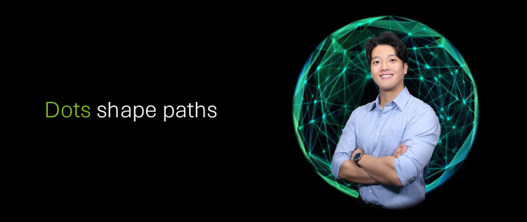

# 职位列表
> 原文链接: https://wecruit.hotjob.cn/SU648133e50dcad45af15e3cb1/mc/position/campus?projectCode=106501

---

-   
-   

简体中文

工作地点

所属机构

Associate - Quantitative Analysis and Valuation (AI enabled) - Audit & Assurance - BJ

审计北京市

3490次浏览2026-08-07更新

Associate - Quantitative Analysis and Valuation (AI enabled) - Audit & Assurance - SH

审计上海市

2977次浏览2026-08-07更新

Analyst - Sustainability & Climate - Strategy & Business Design - Consulting - HK

咨询香港

2488次浏览2026-08-06更新

Associate - Control Assurance (Japanese) - Audit & Assurance - SH

审计上海市

1791次浏览2026-08-05更新

Analyst - Deloitte IBond德勤风驭 - BJ

内部服务北京市

5009次浏览2026-08-03更新

Associate - Financial Risk Management - Audit & Assurance - BJ

审计北京市

1322次浏览2026-08-03更新

Analyst - Regulatory & Financial Risk - Consulting - SH

咨询上海市

6078次浏览2026-08-03更新

Analyst - Regulatory & Financial Risk - Consulting - SZ

咨询深圳市

3850次浏览2026-08-03更新

Analyst - Regulatory & Financial Risk - Consulting - HK

咨询香港

2153次浏览2026-08-03更新

Analyst - Regulatory & Financial Risk - Consulting - BJ

咨询北京市

2557次浏览2026-08-03更新

二维码

分享职位

校园招聘

实习生招聘

全球交付中心

个人中心

简体中文

向上滑动加载更多